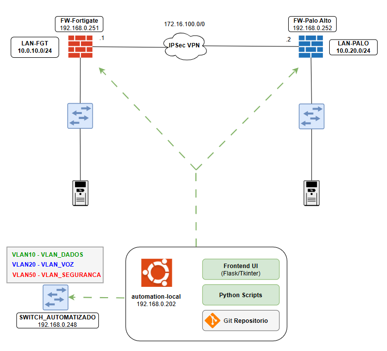

# 🚀 NetOps Automation Portal

<p align="center">
  
  
  
  
</p>

---

## 📋 Visão Geral do Projeto

Portal web e esteira de automação desenvolvidos em **Python**, **Flask** e **WebSockets** para orquestração de redes e segurança corporativa multi-vendor, estruturados em ambiente de laboratório virtualizado com rede de gerência dedicada (`192.168.0.0/24`).

- **Parte 1 — Automação de Switches Cisco:** Provisionamento dinâmico de Hostname, criação de VLANs padronizadas (`10 - VLAN_DADOS`, `20 - VLAN_VOZ`, `50 - VLAN_SEGURANÇA`), validações pós-deploy e sistema automatizado de backup da `running-config` com retenção estrita de até **20 arquivos `.cfg`** (com opção de limpeza manual e download).

- 🎬 **[Parte 1 — Automação de Switches Cisco & Backups (MP4)](docs/video/parte1-cisco-switches.mp4)**

- **Parte 2 — Automação de Túneis VPN IPsec / IKEv2 (Multi-Vendor):** Esteira completa de provisionamento de infraestrutura LAN, deploy de túneis VPN IPsec *Route-Based*, rollback transacional ordenado, validação de conectividade (*Control Plane* e *Data Plane*) e backup automatizado para firewalls **FortiGate (FortiOS)** e **Palo Alto (PAN-OS)**.
- **Console em Tempo Real:** Streaming bidirecional de logs via `Flask-SocketIO` e `Gevent`, permitindo monitorar cada comando SSH e capturar saídas de execução instantaneamente no navegador.

---

## 🖼️ Interface do Portal

<p align="center">
  
</p>

---

## 🛠️ Arquitetura e Tecnologias

- **Backend & Automação:** Python 3.11+, Flask, Flask-SocketIO, Gevent, Netmiko, Paramiko, TQDM
- **Frontend:** Bootstrap 5, Console dinâmico em tempo real via WebSockets
- **Infraestrutura:** Ambiente virtualizado conectado à rede de gerência *Out-of-Band* `192.168.0.0/24`

<p align="center">
  
</p>

---

## 🚀 Como Executar Localmente

Clone o repositório e execute o script automatizado de inicialização (`start.sh`). Ele detecta dinamicamente o IP local da máquina (`PORTAL_IP`), configura o ambiente virtual (`venv`), instala as dependências do `requirements.txt` e inicia o servidor web:

```bash
git clone <url-do-seu-repositorio>
cd netops-automation-portal
chmod +x start.sh
./start.sh
```

O portal estará acessível em: `http://<IP_DO_SERVER>:5000`

### Execução Direta da Esteira VPN (Parte 2)

Para executar os scripts da esteira de VPN IPsec diretamente via linha de comando:

```bash
source venv/bin/activate
cd part2_vpn_ipsec/scripts

# Deploy VPN IPsec (Palo Alto e FortiGate)
python 2.1.deploy_paloalto_vpn.py
python 2.2.depoly_fortigate_vpn.py

# Validação de SAs e conectividade fim-a-fim
python 2.5.validate_vpn_connectivity.py

# Backup das configurações ativas (.xml e .conf)
python 2.6.backup_paloalto.py
python 2.7.backup_fortigate.py
```

---

## 🎥 Demonstração em Vídeo

<!-- Para player nativo do GitHub: edite este arquivo no navegador e arraste o arquivo .mp4 para a linha abaixo -->
<!-- https://github.com/user-attachments/assets/SEU-ASSET-ID -->

[](https://www.youtube.com/watch?v=SEU_ID_DO_VIDEO)

- **Parte 1 (Cisco Switches & Backups):** Provisionamento de Hostname, criação de VLANs (`10`, `20`, `50`), backup automático/manual com limite de 20 arquivos e rollback.
- **Parte 2 (FortiGate & Palo Alto VPN IPsec):** Orquestração de túneis IPsec multi-vendor, políticas de segurança, rotas estáticas, validação de conectividade e backups automatizados.

---

## 📂 Estrutura do Repositório

```text
.
├── docs/
│   └── images/
│       ├── portal-web.png               # Captura de tela da interface web do portal
│       └── topologia-homelab.png        # Diagrama de arquitetura do laboratório
├── git-update.sh                        # Script auxiliar para commit e push rápido no GitHub
├── part1_cisco_switch/
│   ├── app.py                           # Aplicação Flask unificada (WebSockets + Rotas)
│   ├── backups/                         # Repositório de snapshots .cfg (Limite de 20 arquivos)
│   ├── config/
│   │   ├── SWITCH_AUTO_01.cfg
│   │   └── SWITCH_AUTO_02.cfg
│   └── templates/
│       ├── backups.html                 # Gerenciamento, download e limpeza de backups
│       ├── configure.html               # Configuração dinâmica de switches via WebSockets
│       └── index.html                   # Página inicial e visão geral do portal
├── part2_vpn_ipsec/
│   ├── backup/                          # Snapshots .xml (Palo Alto) e .conf (FortiGate)
│   ├── config/                          # Templates declarativos de configuração e remoção
│   │   ├── 1.1.config_palo_alto_lan.cfg
│   │   ├── 1.2.config_fgt_lan.cfg
│   │   ├── 1.4.delete_fgt_lan.cfg
│   │   ├── 1.5.delete_palo_alto_lan.cfg
│   │   ├── 2.1.config_palo_alto_vpn.cfg
│   │   ├── 2.2.config_fgt_vpn.cfg
│   │   ├── 2.3.delete_palo_alto_vpn.cfg
│   │   └── 2.4.delete_fgt_vpn.cfg
│   ├── scripts/                         # Orquestradores Python (Deploy, Rollback, Audit e Backup)
│   │   ├── 1.1.deploy_paloalto_lan.py
│   │   ├── 1.2.deploy_fortigate_lan.py
│   │   ├── 1.3.audit_paloalto_lan.py
│   │   ├── 1.4.rollback_fortigate_lan.py
│   │   ├── 1.5.rollback_paloalto_lan.py
│   │   ├── 2.1.deploy_paloalto_vpn.py
│   │   ├── 2.2.depoly_fortigate_vpn.py
│   │   ├── 2.3.rollback_paloalto_vpn.py
│   │   ├── 2.4.rollback_fortigate_vpn.py
│   │   ├── 2.5.validate_vpn_connectivity.py
│   │   ├── 2.6.backup_paloalto.py
│   │   └── 2.7.backup_fortigate.py
│   └── vpn_architecture.md              # Documentação técnica e arquitetura da Parte 2
├── README.md                            # Documentação oficial do projeto
├── requirements.txt                     # Dependências Python do projeto
├── setup_env.sh                         # Script de preparação do ambiente virtual
└── start.sh                             # Script de inicialização automatizada (IP dinâmico + venv)
```